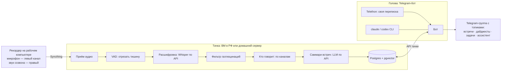

# daybrain: архитектура

Личный ассистент руководителя на своей инфраструктуре. Сам записывает рабочие встречи, расшифровывает их, делает саммари, вытаскивает поручения, собирает дайджесты рабочих чатов и отвечает на вопросы по встречам и переписке. Всё общение идёт через Telegram, данные остаются у владельца.

Здесь только описание устройства, код не публикуется. Описание можно отдать своему Claude Code как ориентир и собрать похожего ассистента под себя.

## Что получает владелец

- **Саммари каждой встречи:** о чём говорили, что решили, кто что делает. Приходит через несколько минут после созвона.
- **Поручения:** что накидали на тебя и что раздал ты, отдельным списком.
- **Дайджест рабочих чатов:** то же самое по переписке, без ручного чтения.
- **Поиск и вопросы:** «Когда мы решили перенести демо и кто был против?» Ответ собирается по встречам и переписке сразу, с указанием источника.

Ручных действий нет: включил компьютер, говоришь, а система сама пишет, расшифровывает и раскладывает.

## Схема

## Компоненты

Система состоит из трёх частей. Тачка и голова могут жить на одной машине.

### Рекордер

Стоит на рабочем компьютере, где проходят встречи. Для Windows есть готовый установщик, для Mac описана сборка.

Пишет микрофон в левый канал, а системный звук созвона — в правый. Поэтому «кто говорит» определяется по громкости каналов: голос владельца размечается без обучения моделей. Куски записи уходят на тачку через Syncthing.

### Тачка

Обработка звука и хранение. Всё запускается через docker compose:

- **Postgres с pgvector:** встречи, расшифровки и вектора для поиска.
- **Syncthing:** приём аудио с рекордера.
- **ingest:** VAD режет тишину → Whisper по API → фильтр галлюцинаций → разметка, кто говорит.
- **summarizer:** саммари встреч по расписанию. Календарь распознаётся со скриншотов.
- **upload API:** загрузки, календарь, поиск.
- **retention:** сжатие и чистка сырого звука.

### Голова

Telegram-бот в группе с топиками: саммари встреч, дайджесты чатов, задачи и поручения, ассистент с поиском по встречам и переписке.

Переписку владельца бот читает через его собственную Telethon-сессию. Для агентских задач (ответы, разбор, поиск) он вызывает `claude` CLI, запасной вариант — `codex` CLI.

## Принципы

1. **Данные не уходят из контура владельца.** Записи, расшифровки и переписка хранятся у него. Расшифровка и саммари идут через провайдеров, которых владелец выбрал сам. По умолчанию это российские Cloud.ru Foundation Models и Yandex.
2. **Агентские задачи — через `claude` CLI, а не через API-ключи.** Ключи API нужны только для расшифровки, распознавания картинок, эмбеддингов и саммари на тачке.
3. **Всё персональное хранится в `.env`.** Имя, id, топики и ключи не попадают в код и промпты, а `.env` не попадает в git.
4. **Сбои видны.** Если фоновая задача падает, в топик логов приходит алерт, а при восстановлении — отбой. Молча глотать ошибки нельзя.
5. **Свои ключи, свои деньги, свой форк.** Каждый разворачивает систему у себя и дальше развивает её своим Claude Code.

## Ключевые решения

| Решение | Почему |
| --- | --- |
| Whisper по API, а не своя GPU | Платишь по факту, без возни с железом. Своя GPU выходит в те же деньги, но требует обслуживания. |
| VAD перед расшифровкой | Тишина не уходит в API: дешевле и меньше выдуманного текста на молчании. |
| Два канала в рекордере | Голос владельца отделяется сразу, обучать диаризацию не нужно. |
| Telegram как интерфейс | Всё в одном месте: саммари, задачи и вопросы, с телефона и компьютера. |
| Модели в РФ по умолчанию | Рабочие разговоры не уезжают за рубеж. Провайдер меняется одной строкой в конфиге. |

## Сколько стоит

Ориентир автора на июль 2026: недорогая ВМ в РФ около 1100 ₽ в месяц плюс оплата API по факту. При полном объёме встреч получается примерно 5–7 тысяч рублей в месяц. Тесты стоят рубли.

## Что понадобится, чтобы собрать своё

- Машина под систему: домашний сервер или недорогая ВМ, лучше в РФ.
- Рабочий компьютер, где проходят встречи, — под рекордер.
- Свой Telegram-бот и рабочая группа с топиками.
- Ключи облака для расшифровки и саммари, свой Claude Code.
- Вечер-другой на первую установку.

## Как использовать этот документ

Дай ссылку на эту страницу своему Claude Code и скажи: «Прочитай архитектуру daybrain и помоги собрать похожего ассистента под меня. Начни с вопросов, что мне нужно».

Честно о главном: это конструктор, а не продукт с кнопкой и поддержкой. Что записывать и хранить, решаешь ты, и ответственность тоже твоя. Записывать чужой голос без ведома людей — тоже на твоей совести.
